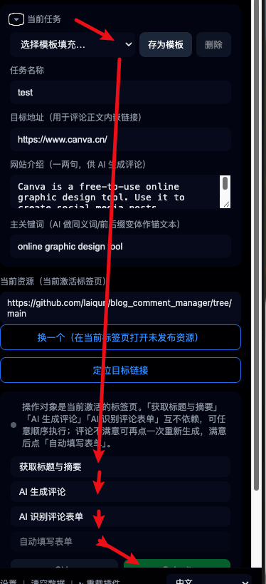
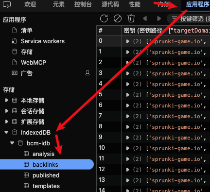

<https://github.com/laiqun/blog_comment_manager>
根据飞哥的帖子 <https://new.web.cafe/topic/6wzfxt0dfm> 搞出来的插件.
根据群友帖子尝试dofollow <https://new.web.cafe/topic/uo59xyoni0>
我还没加全自动发，现在是半自动

悬浮窗我给拿掉了，只有side panel

核心是这4 张表，存在 indexedDB里
根据博客评论里的链接发现新的域名， 我觉得应该叫做扩站，“发现新网站” 这个可以作为另外一个插件，或者另外一个标签页。 一个目标网站一个目标网站的查，这样数据比较有规律。目前没加这功能。
队列中是backlinks-analysis 无效条目是在 analysis 对应条目 enabled 设置为false，这可能不够函数式（直接修改了源对象），但是可以少创建一张表。
